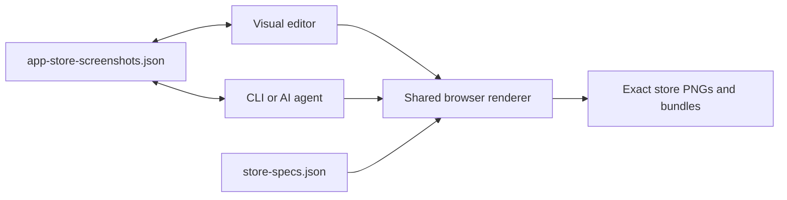

# Screenshot Studio

A code-first, open-source editor for creating App Store, Google Play, and Microsoft Store marketing
screenshots visually, from the CLI, or together with an AI coding agent.

Screenshot Studio keeps an entire campaign in one git-trackable JSON document. The visual editor and
CLI use the same browser renderer, so the preview you approve is the image you export at the exact
store size.

The application is local-first, works without an AI provider, and supports reproducible campaigns
across platforms, layouts, exact-size variants, locales, and RTL languages.

## Why Screenshot Studio

Store screenshots are rarely a one-image task. A complete campaign must stay visually consistent
across device sizes, platforms, locales, RTL languages, product revisions, and repeated exports.
Traditional design files are convenient to edit but difficult to automate and review in Git.
Code-only generators are reproducible but inconvenient for visual iteration.

Screenshot Studio combines both workflows:

- a responsive multi-artboard visual editor;
- one strict, portable, version-controlled project document;
- a CLI for repeatable editing, import, and export;
- exact store-size outputs produced by the same renderer as the editor preview;
- project-local instructions that let an AI agent work against explicit schema and workflow rules;
- no required cloud service, model, API key, or provider-specific project state.

## Current capabilities

- **One strict project document.** A complete strict schema v1 JSON file owns shared metadata and
  fonts plus ordered independent design layouts, locales, screens, backgrounds, elements, groups,
  crop/style literals, output-family policies, and store target variants.
- **One UI/CLI renderer.** Editor previews, exact exports, bundles, Web Share, and the packaged CLI
  use the same Konva stage through the Chromium render host. Store PNGs are exact-size and opaque.
- **Visual authoring.** Focus and Overview modes, isolated and connected canvases, multi-selection,
  one-level groups, snapping, guides, zoom, inline text editing, history, and schema-bounded
  inspectors work across layouts and locales.
- **Complete creative surface.** Text, shapes, screenshots, decorative images, trusted vector icons,
  device frames, editable badge groups, solid/gradient/project-image backgrounds, media crop,
  shadows, gradients, and strokes share render/export parity.
- **Store and locale workflows.** Apple, Android, Windows, and responsive Web output families,
  explicit exact-size variants, synchronized or independent screen slots, complete locale sets, and
  baked RTL geometry use the same project model.
- **Reusable local resources.** Built-in starters and Design Packs work alongside project-local
  fonts, themes, templates, assets, auto-crop, and flat-background removal.
- **CLI and agent workflows.** The `screenshots` CLI manages layouts, screens, imports, fonts,
  themes, locales, local assets, and exports. Generated project-local guidance and the optional
  [agent skill](skills/screenshot-studio/SKILL.md) operate on the same strict JSON and CLI contract.
- **Safe project lifecycle.** Local projects can be edited in place; browser imports create validated
  managed copies. Project archives, rendered exports, Close, Remove from recents, and permanent
  deletion remain separate, explicit operations.

## Example project

The Store Launch Demo shows one campaign authored across iPhone and iPad, with synchronized screen
structure, exact-size output variants, and element-level visual controls.

Start with a guided project or import an existing Folder, project ZIP, or complete JSON document.


Return to recent projects without moving or rewriting their source files.


Use Overview to edit a connected campaign across destinations, screens, and store sizes, then export
the same composition through the shared renderer.


<details>
<summary><strong>See element and screen controls</strong></summary>

Select a device frame to adjust its transform, screenshot content, and frame preset.


Select a screen to manage synchronized structure, destinations, exact output sizes, and background.


</details>

## Quick start

Requirements: Node.js 22.13+ and pnpm 12.10.1, the version pinned in `package.json`. Install pnpm
once with `npm install -g pnpm@12.10.1`; an existing Corepack setup also works.

```bash
git clone https://github.com/VitaliiDeveloper/Screenshot-Studio.git && cd Screenshot-Studio
./run.sh
```

`./run.sh` is the only command you need. It installs or refreshes the pinned dependencies and the
Playwright Chromium builds used for export when they are missing or outdated (a quick no-op
otherwise), then starts Screenshot Studio.

| Task | Command |
|---|---|
| Start | `./run.sh` |
| Update | `git pull && ./run.sh` |
| Prepare without starting | `./install.sh` |
| Recover from a stale build cache | `./clean.sh && ./run.sh` |

None of these scripts removes projects or exports.

Open [http://localhost:3000](http://localhost:3000), then choose **New project** and a built-in
starter, or use **Import** to create a managed copy of an existing Folder, project ZIP, or complete
`app-store-screenshots.json` project.

To open the bundled sample directly in place:

```bash
PROJECT_PATH="$PWD/fixtures/sample/app-store-screenshots.json" pnpm dev
```

The sample appears in **Recent projects** and opens directly in Workspace. Editor saves update the
fixture in place, so copy it to a separate directory before experimenting with changes you do not
want to keep.

Exact PNG export uses the Chromium builds that `./run.sh` installs. From the CLI:

```bash
pnpm screenshots export --project "$PWD/fixtures/sample/app-store-screenshots.json"
```

## How it works



`app-store-screenshots.json` is the single persisted project document. Store dimensions come from
[`store-specs.json`](store-specs.json). The visual editor and CLI both use the framework-agnostic
core and the same browser render stage; Web Share packages those rendered PNGs and never substitutes
another pixel path.

### Destinations, output families, sizes, and frames

These concepts are independent:

| Concept | Example | What it controls |
|---|---|---|
| Destination | App Store or Google Play | The publishing surface and its configured output families |
| Device family | iPhone or Android phone | A destination-scoped group of compatible export targets |
| Export size | 1320×2868 or 1080×1920 | The exact pixel dimensions of one rendered PNG |
| Visual frame preset | Modern Phone — Dark or Browser — Dark | Only the decorative device-frame element drawn inside an artboard |

Choosing a frame never changes a screen's destination, device family, or export size. Screenshot
Studio bundles brand-neutral vector frame styles rather than vendor product artwork; official Apple
device artwork is not bundled.

The sizes in [`store-specs.json`](store-specs.json) are a curated working set: accepted Apple sizes
and recommended presets within Google Play and Microsoft Store requirements. They are not a claim
that every historically accepted resolution is bundled. Store requirements change, so
`store-specs.json` remains the runtime authority for what this version exports, while the official
[App Store screenshot specifications](https://developer.apple.com/help/app-store-connect/reference/app-information/screenshot-specifications/),
[Google Play preview-asset requirements](https://support.google.com/googleplay/android-developer/answer/9866151?hl=en),
and [Microsoft Store screenshot guidance](https://learn.microsoft.com/en-us/windows/apps/publish/publish-your-app/msix/screenshots-and-images)
remain the submission authority. Check the relevant store guidance before publishing.

Projects can be opened explicitly as local files or imported into app-managed storage. A browser
Folder, ZIP, or JSON selection is always treated as import input, validated, and copied before the
managed project becomes active. Detailed source, session, rendering, and persistence contracts are
in [`docs/architecture.md`](docs/architecture.md).

## CLI workflow

The monorepo CLI covers the common project lifecycle:

```bash
# Create a strict project with local agent guidance
pnpm screenshots init --dir ./my-app-screenshots

# Open its visual editor
pnpm screenshots dev --project ./my-app-screenshots/app-store-screenshots.json

# Export the preferred layout
pnpm screenshots export --project ./my-app-screenshots/app-store-screenshots.json

# Import organized PNG captures into a selected layout
pnpm screenshots import ./my-app-screenshots/screenshots \
  --layout "Feature campaign" \
  --project ./my-app-screenshots/app-store-screenshots.json
```

Layout-aware mutations require `--layout <id-or-full-name>` when a project has multiple layouts.
`dev`, `screen`, and `export` accept `--store-specs <path>` for an explicit store specification.
Bundle export writes locale roots at their device lead target and all explicit persisted variants at
their own targets. A single-screen export resolves explicit `--size`, then its persisted `storeTargetId`,
then its device lead target. `screen rm <id> --cascade` explicitly removes a primary
screen together with paired variants.

The full command and export reference lives in
[`packages/cli/README.md`](packages/cli/README.md).

## Project format and resources

A portable screenshot project commonly has this shape:

```text
my-app-screenshots/
├── app-store-screenshots.json   # the only persisted project document
├── AGENTS.md                    # generated schema and workflow guidance
├── assets/                      # screenshots, images, fonts, and processed assets
├── screenshots/                 # organized PNG captures for import
├── templates/<id>.json          # project-local screen templates
├── themes/<id>.json             # project-local themes
└── export/                      # generated outputs
```

Built-in screen starters, Design Packs, frames, icons, and fonts are application resources and do
not become hidden project state. Applying a starter, template, or pack materializes ordinary strict
project fields that remain editable. Project-local resources stay beside the document and can travel
with its portable project archive.

Four living starter workflows cover isolated, connected, RTL/multi-locale, and capture-import paths.
The self-contained projects under [`examples/`](examples/README.md) are also validated and exported
as part of the repository's release surfaces.

## Installable CLI candidate

To build the local installable artifact without publishing it:

```bash
pnpm build:cli-package
pnpm --dir packages/cli/package pack
pnpm add --global ./packages/cli/package/screenshot-studio-cli-0.1.0.tgz
screenshots setup
screenshots init --dir ./my-app-screenshots
```

`screenshots setup` downloads the Chromium builds (about 550 MB, in Playwright's shared per-user
cache) using the Playwright version the CLI depends on; it is safe to re-run. Without it,
`screenshots export` asks before downloading on first use and, in CI or other non-interactive
runs, exits with the install command instead of downloading. On Linux, Chromium may also need
Playwright's [system packages](https://playwright.dev/docs/browsers#install-system-dependencies).

Interactive runs of the installed package (not a source checkout, which updates with `git pull`)
also make one optional request per day to the public npm registry
(`registry.npmjs.org/@screenshot-studio/cli/latest`) and print a one-line notice when a newer
version exists. Nothing is sent but the request itself, and failures are ignored. Disable it with
`SCREENSHOTS_NO_UPDATE_CHECK=1` or `NO_UPDATE_NOTIFIER=1`; it is also skipped when `CI` is set or
output is not a terminal.

The package contains the built `screenshots` binary, shared store specifications, and prebuilt Next
render host. Version `0.1.0` is an unpublished dry-run candidate; it is not a registry release.
Building or verifying it does not create an npm publication, Git tag, GitHub release, or
announcement. Publication requires explicit owner authorization under
[`docs/releasing.md`](docs/releasing.md).

## Repository structure

- `packages/core` — strict model, project operations, renderer mapping, export, resources, and store
  specifications.
- `packages/cli` — the `screenshots` command and packaged standalone render host.
- `apps/web` — Projects, Project details, Workspace, API routes, and the shared `/render` target.
- `fixtures` — sample and behavior-specific regression projects.
- `examples` — portable connected and RTL living projects.
- `e2e` — focused Playwright/Vitest workflow and render-parity gates.
- `docs` — durable architecture, interaction, testing, safety, and release contracts.

## Documentation

- [Architecture](docs/architecture.md) — model, sources, sessions, rendering, export, and CLI.
- [Editor UI and UX](docs/editor.md) — durable interaction, navigation, and accessibility semantics.
- [Testing](docs/testing.md) — test ownership, focused browser groups, and CI policy.
- [Project mutation locking](docs/project-mutation-locking.md) — concurrent write and recovery contract.
- [Safe file publication](docs/safe-file-publication.md) — asset and output publication boundaries.
- [Releasing](docs/releasing.md) — candidate verification, publication, upgrade, and uninstall.
- [Contributing](CONTRIBUTING.md) and [Security](SECURITY.md) — contributor workflow and private
  vulnerability reporting.

## Development

```bash
pnpm test          # full unit suite
pnpm test:core     # core unit tests
pnpm test:cli      # CLI unit tests
pnpm test:web      # web unit tests
pnpm typecheck     # all packages
pnpm lint          # repository lint
```

Use focused browser files only for behavior that requires a real Next.js host, rendering, user
interaction, or persistence. Do not run the complete `pnpm test:e2e` gate locally; GitHub CI owns it
for the integration PR from `dev` into `main`. See [`docs/testing.md`](docs/testing.md) for the exact
matrix and release-surface commands.

## License

Apache-2.0 — see [LICENSE](LICENSE) and [NOTICE](NOTICE). Contributions are welcome under the same
terms; see [CONTRIBUTING.md](CONTRIBUTING.md).
