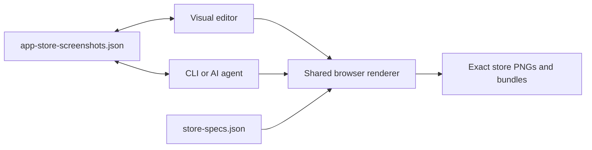

# Screenshot Studio

A code-first, open-source editor for creating App Store, Google Play, and Microsoft Store marketing
screenshots visually, from the CLI, or together with an AI coding agent.

Screenshot Studio keeps an entire campaign in one git-trackable JSON document. The visual editor and
CLI use the same browser renderer, so the preview you approve is the image you export at the exact
store size.

The application is local-first, works without an AI provider, and supports reproducible campaigns
across platforms, layouts, exact-size variants, locales, and RTL languages.

## Why Screenshot Studio

Store screenshots are rarely a one-image task. A complete campaign must stay visually consistent
across device sizes, platforms, locales, RTL languages, product revisions, and repeated exports.
Traditional design files are convenient to edit but difficult to automate and review in Git.
Code-only generators are reproducible but inconvenient for visual iteration.

Screenshot Studio combines both workflows:

- a responsive multi-artboard visual editor;
- one strict, portable, version-controlled project document;
- a CLI for repeatable editing, import, and export;
- exact store-size outputs produced by the same renderer as the editor preview;
- project-local instructions that let an AI agent work against explicit schema and workflow rules;
- no required cloud service, model, API key, or provider-specific project state.

## Current capabilities

- **One strict project document.** A complete strict schema v1 JSON file owns shared metadata and
  fonts plus ordered independent design layouts, locales, screens, backgrounds, elements, groups,
  crop/style literals, output-family policies, and store target variants.
- **One UI/CLI renderer.** Editor previews, exact exports, bundles, Web Share, and the packaged CLI
  use the same Konva stage through the Chromium render host. Store PNGs are exact-size and opaque.
- **Visual authoring.** Focus and Overview modes, isolated and connected canvases, multi-selection,
  one-level groups, snapping, guides, zoom, inline text editing, history, and schema-bounded
  inspectors work across layouts and locales.
- **Complete creative surface.** Text, shapes, screenshots, decorative images, trusted vector icons,
  device frames, editable badge groups, solid/gradient/project-image backgrounds, media crop,
  shadows, gradients, and strokes share render/export parity.
- **Store and locale workflows.** Apple, Android, Windows, and responsive Web output families,
  explicit exact-size variants, synchronized or independent screen slots, complete locale sets, and
  baked RTL geometry use the same project model.
- **Reusable local resources.** Built-in starters and Design Packs work alongside project-local
  fonts, themes, templates, assets, auto-crop, and flat-background removal.
- **CLI and agent workflows.** The `screenshots` CLI manages layouts, screens, imports, fonts,
  themes, locales, local assets, and exports. Generated project-local guidance and the optional
  Codex skill operate on the same strict JSON and CLI contract.
- **Safe project lifecycle.** Local projects can be edited in place; browser imports create validated
  managed copies. Project archives, rendered exports, Close, Remove from recents, and permanent
  deletion remain separate, explicit operations.

## How Codex and GPT-5.6 were used

Screenshot Studio was built through an AI-assisted product and engineering workflow using OpenAI
Codex and GPT-5.6.

These tools were involved in approximately 99% of the project's development activities: from the
initial product idea and planning through repeated product and UI redesigns, architecture,
implementation, testing, refactoring, documentation, and release-readiness work. The percentage
describes the breadth of AI involvement across the development process; it does not mean the product
was generated in one prompt or completed without human direction, review, and acceptance.

The product vision, priorities, constraints, final decisions, reviews, and acceptance remained the
responsibility of the human author.

### Collaboration model

The project used a repeated human–AI development loop rather than a one-shot generation workflow:

1. The human author defined the desired product outcome, constraints, and acceptance criteria.
2. Codex inspected the existing repository and the smallest relevant architecture, product, schema,
   and testing contracts.
3. Codex and GPT-5.6 helped explore alternatives, surface edge cases, and explain trade-offs.
4. The human author selected the direction and authorized the implementation scope.
5. Codex implemented the scoped change and ran verification proportionate to its risk.
6. The human author reviewed behavior, product quality, visual results, and proposed follow-up work.
7. Review findings were fed back into the next focused iteration.

Repository-level [`AGENTS.md`](AGENTS.md) and [`RULES.md`](RULES.md) files made this collaboration
explicit. They route work to the relevant source of truth, protect the strict schema and shared
renderer, constrain broad or destructive actions, define test ownership, and keep release
publication separate from implementation.

### Product discovery, strategy, and scope

Codex and GPT-5.6 helped turn the original idea into a concrete product:

- break the concept into implementation stages and reviewable milestones;
- identify developers, indie teams, localization workflows, and AI-assisted authoring as target use
  cases;
- compare a visual-only editor with code-first and hybrid approaches;
- define local-first operation and a portable project format as product constraints;
- distinguish editable project archives from rendered store-image export;
- prioritize render/export parity over shortcuts that would create a second rendering path;
- refine Screenshot Studio's positioning as both a visual tool and an automation-friendly project
  format.

The human author determined the product vision, which trade-offs to accept, which features to ship,
and when an iteration met the intended outcome.

### UI/UX design and repeated redesigns

AI supported many iterations of the application experience, including:

- project creation, complete project import, screenshot capture import, and first-run onboarding;
- the Projects gallery, recent-project behavior, project details, archive export, and deletion;
- Workspace navigation, responsive toolbars, panels, empty states, and compact layouts;
- Focus and Overview editing modes;
- isolated and connected canvas models;
- layout, output-family, exact-size, locale, screen, layer, and selection interactions;
- accessible dialogs, focus behavior, keyboard controls, destructive confirmations, and status
  feedback;
- alternative interface concepts, mockups, visual hierarchy, and product copy.

Design tools and plugins were used during exploration and implementation to create and inspect
mockups, compare visual directions, and translate selected concepts into implementable UI. Codex
helped turn accepted directions into production React components and focused interaction tests. The
human author compared the alternatives, judged the visual result, and approved the final product
decisions.

### Architecture and implementation

Codex assisted with TypeScript, React, and Next.js development across the repository. Important
areas included:

- the strict Zod schema and the single `app-store-screenshots.json` document;
- independent layouts, connected compositions, exact-size variants, output-family screen-slot
  policies, locale cloning, and baked RTL geometry;
- the shared core used by the visual editor and CLI;
- the browser rendering pipeline and render/export parity;
- project-local fonts, themes, templates, Design Packs, icons, frames, and image assets;
- local-file and managed project sources, active-session identity, recent-project history, and
  request fencing;
- bounded Folder, ZIP, JSON, and raw screenshot import workflows;
- project mutation locking and recovery across CLI and editor processes;
- safe, collision-resistant asset and output publication;
- the installable CLI package and its standalone shared render host;
- Web Share packaging without introducing a second pixel renderer;
- the optional Screenshot Studio Codex skill and generated project-local agent guide.

One architectural invariant guided the work throughout: the editor and CLI must use the same shared
core and browser renderer. A feature was not considered complete if preview and export could disagree
about pixels, fonts, crops, geometry, or output size. The durable technical contract is documented in
[`docs/architecture.md`](docs/architecture.md).

### Testing, investigation, and review

Codex and GPT-5.6 were used not only to write implementation code but also to challenge it:

- identify failure modes and edge cases before and after implementation;
- select the smallest meaningful test layer for each change;
- write and maintain unit, integration, render-parity, package, accessibility, and browser tests;
- validate exact output dimensions and opaque store PNGs;
- compare headed editor rendering with headless CLI rendering;
- review local path, symlink, archive, upload, mutation, and publication boundaries;
- diagnose regressions from test output and concrete repository evidence;
- review documentation against the current schema, source code, tests, workflows, and packaged
  artifact;
- audit the local release candidate's contents, licenses, runtime dependencies, and portability.

Tests were chosen according to risk rather than by running every browser scenario for every change.
Exact unit or integration tests own deterministic behavior; focused browser files own workflows that
require a real Next.js host, browser interaction, persistence, or rendering. The complete ownership
matrix is in [`docs/testing.md`](docs/testing.md).

### Documentation and developer experience

Codex helped create, review, and maintain:

- this README and the public project positioning;
- architecture and editor interaction contracts;
- testing, contribution, and release guidance;
- project mutation-locking and safe file-publication documentation;
- repository and project-local agent workflow rules;
- CLI and example-project documentation;
- the generated `AGENTS.md` included in every initialized screenshot project.

Documentation was treated as part of the product rather than a final summary. It was repeatedly
checked against the live schema, command dispatcher, UI routes, CI workflows, tests, and locally
packed CLI. Detailed contracts live in `docs/` so the main README can explain the product and the
AI-assisted development story without becoming the only source of technical truth.

### Human responsibility and control

The human author remained responsible for:

- the original idea, product goals, priorities, and scope;
- choosing between proposed product, design, and architecture alternatives;
- reviewing visual quality and interaction behavior;
- accepting or rejecting implementation changes;
- deciding when additional verification was required;
- approving all final product and technical decisions;
- authorizing any release or publication action.

Codex did not independently publish packages, create Git tags or GitHub releases, or broaden a task
beyond its authorized scope. Builds and passing checks never served as publication approval.

### AI-assisted, not AI-dependent

AI was central to building Screenshot Studio, but it is not a runtime dependency of the product.
The editor and CLI require no model, provider SDK, API key, or persisted AI state. Projects remain
readable, editable, exportable, and portable without an agent.

For users who want an AI-assisted workflow, `screenshots init` generates a project-local `AGENTS.md`
that documents the enforced schema, authoring boundaries, supported CLI operations, and verification
recipes. The optional [`skills/screenshot-studio`](skills/screenshot-studio/SKILL.md) Codex skill only
discovers or initializes a project and then delegates to that local contract. This separation lets AI
accelerate authoring without locking the project to one model, provider, or hidden project format.

## Quick start

Requirements: Node.js 22.13+, Corepack, and the pinned pnpm 11 toolchain.

```bash
git clone https://github.com/VitaliiDeveloper/Screenshot-Studio.git && cd Screenshot-Studio
corepack enable
pnpm install
pnpm dev
```

Open [http://localhost:3000](http://localhost:3000), then choose **New project** and a built-in
starter, or use **Import** to create a managed copy of an existing Folder, project ZIP, or complete
`app-store-screenshots.json` project.

To open the bundled sample directly in place:

```bash
PROJECT_PATH="$PWD/fixtures/sample/app-store-screenshots.json" pnpm dev
```

The sample appears in **Recent projects** and opens directly in Workspace. Editor saves update the
fixture in place, so copy it to a separate directory before experimenting with changes you do not
want to keep.

Exact PNG export additionally requires the matching Playwright browser builds once per machine:

```bash
pnpm exec playwright install chromium chromium-headless-shell
pnpm screenshots export --project "$PWD/fixtures/sample/app-store-screenshots.json"
```

## How it works



`app-store-screenshots.json` is the single persisted project document. Store dimensions come from
[`store-specs.json`](store-specs.json). The visual editor and CLI both use the framework-agnostic
core and the same browser render stage; Web Share packages those rendered PNGs and never substitutes
another pixel path.

Projects can be opened explicitly as local files or imported into app-managed storage. A browser
Folder, ZIP, or JSON selection is always treated as import input, validated, and copied before the
managed project becomes active. Detailed source, session, rendering, and persistence contracts are
in [`docs/architecture.md`](docs/architecture.md).

## CLI workflow

The monorepo CLI covers the common project lifecycle:

```bash
# Create a strict project with local agent guidance
pnpm screenshots init --dir ./my-app-screenshots

# Open its visual editor
pnpm screenshots dev --project ./my-app-screenshots/app-store-screenshots.json

# Export the preferred layout
pnpm screenshots export --project ./my-app-screenshots/app-store-screenshots.json

# Import organized PNG captures into a selected layout
pnpm screenshots import ./my-app-screenshots/screenshots \
  --layout "Feature campaign" \
  --project ./my-app-screenshots/app-store-screenshots.json
```

Layout-aware mutations require `--layout <id-or-full-name>` when a project has multiple layouts.
`dev`, `screen`, and `export` accept `--store-specs <path>` for an explicit store specification.
Bundle export writes locale roots at their device lead target and all explicit persisted variants at
their own targets. A single-screen export resolves explicit `--size`, then its persisted `storeTargetId`,
then its device lead target. `screen rm <id> --cascade` explicitly removes a primary
screen together with paired variants.

The full command and export reference lives in
[`packages/cli/README.md`](packages/cli/README.md).

## Project format and resources

A portable screenshot project commonly has this shape:

```text
my-app-screenshots/
├── app-store-screenshots.json   # the only persisted project document
├── AGENTS.md                    # generated schema and workflow guidance
├── assets/                      # screenshots, images, fonts, and processed assets
├── screenshots/                 # organized PNG captures for import
├── templates/<id>.json          # project-local screen templates
├── themes/<id>.json             # project-local themes
└── export/                      # generated outputs
```

Built-in screen starters, Design Packs, frames, icons, and fonts are application resources and do
not become hidden project state. Applying a starter, template, or pack materializes ordinary strict
project fields that remain editable. Project-local resources stay beside the document and can travel
with its portable project archive.

Four living starter workflows cover isolated, connected, RTL/multi-locale, and capture-import paths.
The self-contained projects under [`examples/`](examples/README.md) are also validated and exported
as part of the repository's release surfaces.

## Installable CLI candidate

To build the local installable artifact without publishing it:

```bash
pnpm build:cli-package
pnpm --dir packages/cli/package pack
pnpm add --global ./packages/cli/package/screenshot-studio-cli-0.1.0.tgz
screenshots init --dir ./my-app-screenshots
```

The package contains the built `screenshots` binary, shared store specifications, and prebuilt Next
render host. Version `0.1.0` is an unpublished dry-run candidate; it is not a registry release.
Building or verifying it does not create an npm publication, Git tag, GitHub release, or
announcement. Publication requires explicit owner authorization under
[`docs/releasing.md`](docs/releasing.md).

## Repository structure

- `packages/core` — strict model, project operations, renderer mapping, export, resources, and store
  specifications.
- `packages/cli` — the `screenshots` command and packaged standalone render host.
- `apps/web` — Projects, Project details, Workspace, API routes, and the shared `/render` target.
- `fixtures` — sample and behavior-specific regression projects.
- `examples` — portable connected and RTL living projects.
- `e2e` — focused Playwright/Vitest workflow and render-parity gates.
- `docs` — durable architecture, interaction, testing, safety, and release contracts.

## Documentation

- [Architecture](docs/architecture.md) — model, sources, sessions, rendering, export, and CLI.
- [Editor UI and UX](docs/editor.md) — durable interaction, navigation, and accessibility semantics.
- [Testing](docs/testing.md) — test ownership, focused browser groups, and CI policy.
- [Project mutation locking](docs/project-mutation-locking.md) — concurrent write and recovery contract.
- [Safe file publication](docs/safe-file-publication.md) — asset and output publication boundaries.
- [Releasing](docs/releasing.md) — candidate verification, publication, upgrade, and uninstall.
- [Contributing](CONTRIBUTING.md) and [Security](SECURITY.md) — contributor workflow and private
  vulnerability reporting.

## Development

```bash
pnpm test          # full unit suite
pnpm test:core     # core unit tests
pnpm test:cli      # CLI unit tests
pnpm test:web      # web unit tests
pnpm typecheck     # all packages
pnpm lint          # repository lint
```

Use focused browser files only for behavior that requires a real Next.js host, rendering, user
interaction, or persistence. Do not run the complete `pnpm test:e2e` gate locally; GitHub CI owns it
for the integration PR from `dev` into `main`. See [`docs/testing.md`](docs/testing.md) for the exact
matrix and release-surface commands.

## License

Apache-2.0 — see [LICENSE](LICENSE) and [NOTICE](NOTICE). Contributions are welcome under the same
terms; see [CONTRIBUTING.md](CONTRIBUTING.md).
