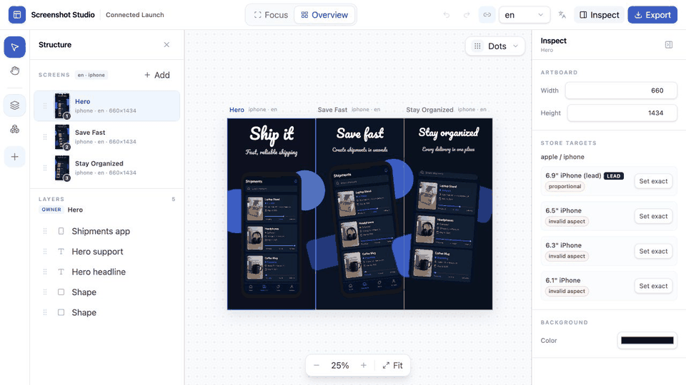

# Screenshot Studio

A code-first, open-source editor for App Store and Google Play marketing screenshots:
a visual Konva canvas with screens, editable elements, fonts, themes, and pixel-correct
export to exact store sizes — driven by the same `core` from both a web UI and a CLI.

The project state lives in a single git-trackable JSON file, so decks are versionable,
reproducible, automatable in CI, and give an AI agent a clean contract to work against.



## Quick start

```bash
git clone https://github.com/VitaliiDeveloper/Screenshot-Studio.git && cd Screenshot-Studio
corepack enable      # resolves the pinned pnpm 11 on a fresh machine
pnpm install
pnpm dev             # editor → http://localhost:3000/editor (opens the bundled sample project)
```

To edit your own project instead of the bundled sample, point `PROJECT_PATH` at its JSON —
relative paths resolve from the directory you run the command in:

```bash
PROJECT_PATH=./my-app-screenshots/app-store-screenshots.json pnpm dev
```

Exporting store-ready PNGs (and the e2e suite) additionally needs a one-time Playwright
browser download — see **Requirements** below.

To build the installable CLI artifact locally (this does not publish it):

```bash
pnpm build:cli-package
pnpm --dir packages/cli/package pack
pnpm add --global ./packages/cli/package/screenshot-studio-cli-0.0.0.tgz
screenshots init --dir ./my-app-screenshots
```

The resulting package contains a built `screenshots` bin and the prebuilt shared Next render host;
it does not need the monorepo or `tsx` after installation.

The optional Codex skill can be installed from the same checkout after the CLI artifact is made
available on `PATH`:

```bash
mkdir -p ~/.codex/skills
cp -R skills/screenshot-studio ~/.codex/skills/screenshot-studio
```

It only discovers or initializes a project and then follows the generated project-local
`AGENTS.md`; normal CLI/editor use does not require the skill or any AI provider.

## Documentation

- [docs/vision.md](docs/vision.md) — strategy, positioning, license, distribution _(changes rarely)_
- [docs/architecture.md](docs/architecture.md) — stack, core/shell, data model, render/export parity, CLI & conventions _(the technical contract)_
- [docs/roadmap.md](docs/roadmap.md) — MVP scope, phased plan, technical risks, exit criteria _(changes often)_

## Project structure

Monorepo (pnpm workspaces):

- `packages/core` — framework-agnostic model (Zod schema), render engine, export, fonts, themes,
  asset loading, storage. The single source of truth for rendering (architecture.md §2).
- `packages/cli` — the `screenshots` command (`init`, `dev`, `export`, screen/import/font/theme/locale/canvas
  management, and non-destructive local asset processing).
- `apps/web` — the Next.js host: `/editor` (interactive multi-artboard workspace), `/render`
  (the headless render target the CLI drives for export), and the `/api/project` +
  `/api/asset` routes that back both.
- `fixtures/` — sample projects used by tests and local dev (e.g. `phase-0-sample`).
- `examples/` — self-contained v5 connected and RTL projects that are validated, edited, and
  exported in the closure suite.
- `e2e/` — Playwright-driven behavioral gates (render/export parity, editor round-trip,
  left-panel interactions).
- `docs/` — vision, architecture, roadmap, and per-slice design specs/plans.
- `store-specs.json` — Apple/Google export sizes (data, not hardcoded).

A screenshots *project* (the JSON file a user edits, as opposed to this repo) has its own
layout — see [AGENTS.md § Repo conventions](AGENTS.md#repo-conventions-the-api).

## Status

**Phase 0 (render/export parity spike) — done.** One project JSON renders to a pixel-correct
PNG from the same web renderer used by both the browser and the CLI, verified on the hardest
case (an embedded custom font).

**Phase 1 (web editor) — done.** The interactive `/editor` canvas covers `text`, `shape`,
`screenshot`, and `device-frame` elements over a shared render path, with select / move /
resize / rotate, inline text edit, a screens + layers left panel (reorder, lock, hide, rename),
a per-type inspector (plus a no-selection artboard/background editor), and a toolbar
(insert-on-click for `text`/`shape`, zoom).

**Phase 2 (verified export) — done.** CLI and UI export both use the same headless `/render`
path, produce exact lead-size bundles with no alpha channel, and write zip output. The CLI also
ships `dev`, `import`, and `screen add/list/rm/reorder` for dogfooding end-to-end project
workflows. See [docs/roadmap.md](docs/roadmap.md).

**Phase 3 (fonts, themes, templates) — done.** File-backed custom/Google font ingest and
editor management are shipped. The strict baked theme model, `theme set` CLI, editor role picker,
Themes dialog, and project-local template library are shipped.

**Phase 3.5 (editor UI polish) — done.** The editor now uses a consistent creative-workbench shell:
grouped actions, clearer panels and inspector fields, one dialog system, real icons, actionable
resource empty states, and visible keyboard focus. No schema, renderer, or persistence behavior changed.

**Phase 3.6 (editor workspace foundation) — done.** The editor now has Focus and isolated-artboard
Overview modes, a compact tool rail with collapsible Structure/Resources/Add shelves, a searchable
creation catalog, pointer-centred wheel/pinch zoom, Hand/Space pan, Fit, `Dots | Grid | None`, and a
responsive inspector/canvas layout. Closure QA also hardens live viewport changes, locked elements,
inline text editing, contain-image transforms, schema-bounded Inspector input, save errors, and
keyboard behavior. The bundled sample is a realistic three-screen launch deck.

**Phase 4 (locales and RTL) — done.** Complete locale-set core/CLI/editor workflows, explicit baked
RTL render parity, collision-safe multi-locale bundle paths, and per-platform/device/locale store-slot
numbering are shipped.

**Phase 5 (agent workflows and local image processing) — done.** `screenshots init` creates
non-overwriting project-local `AGENTS.md` / `CLAUDE.md` instructions with copy, baked auto-layout,
locale-translation, and asset-processing recipes. Local auto-crop and honest flat/near-uniform
background removal write new PNGs without touching source assets or project JSON. The generated
workflow and both commands are dogfooded, and the full closure gate passes.

**Phase 6 (connected canvas and completion foundations) — done.** Schema v2, lossless v1 migration,
connected UI/CLI crop parity, lifecycle-safe operations,
guarded canvas-mode CLI, gapless owner-aware connected authoring, and bounded persisted undo/redo.
Zoom-correct connected-space snapping, ephemeral smart guides, and safe project-local insertion of
existing screenshot/device-frame elements now ship as well. The connected workspace now keeps
mode control, exact-group Screens/Overview/Fit, owner Layers, thumbnails, history, and compact
keyboard behavior coherent. A built installable CLI now packages the same Next render host and is
smoke-tested from a temporary offline install through exact export; it is not a registry release.
The optional skill is installable, delegates to the generated guide, and is clean-folder
smoke-tested without an implicit network fetch. The real editor GIF, contribution/license surfaces,
living connected/RTL examples, and enforced SPDX policy complete the Phase 6 community foundation.
**Phase 7 (advanced editing + baseline completion) — done.** Owner-aware modified-click/marquee
multi-selection and atomic batch actions ship, followed by a strict v3 one-level group model with
lossless v1/v2 migration and shared UI/CLI connected-crop parity. Group authoring/Layers and the
strict v4 decorative image leaf now ship with secure asset insertion plus contain/cover/alpha
parity. Strict v5 trusted built-in vector icons now add editable colour/stroke controls without raw
SVG input. Rating and press-proof badges now use editable ordinary groups, and official store badges
reuse secure contain-fit project images without a redundant schema type. Living v5 projects prove
connected image/icon/badge/group crops plus keyboard group workflows across LTR/RTL locale groups.
Phase 6 and Phase 7 complete the planned baseline. Phase 8 stabilization/release readiness is now
in progress: failure/recovery hardening and the cross-environment packaged-install matrix are
complete, with export soak/performance budgets next. No public release is claimed yet.

## Requirements

- **Node.js 22.13+** and **pnpm 11** (pinned in `package.json` via `engines` and
  `packageManager`). The simplest
  way to get the exact version on a fresh clone is Corepack:

  ```bash
  corepack enable   # then `pnpm …` in this repo resolves to the pinned pnpm 11.10.0
  ```

  pnpm 10/11 blocks package build scripts by default (`ERR_PNPM_IGNORED_BUILDS`), which would
  leave the headless renderer the e2e/parity suite drives without its native deps. The repo
  allowlists exactly the two builds that matter — `esbuild` and `sharp` — via `allowBuilds` in
  [`pnpm-workspace.yaml`](pnpm-workspace.yaml), so `pnpm install` builds them automatically with
  no manual `pnpm approve-builds` step.
- A one-time Playwright browser download (the CLI renders through a headless browser):

```bash
pnpm exec playwright install chromium chromium-headless-shell
```

Both browser builds are needed: the parity check compares a headed (`chromium`) render against
a headless (`chromium-headless-shell`) one.

## Usage

### CLI (`init` / `export` / project management)

```bash
# Scaffold a project (writes JSON, standard directories, AGENTS.md, and CLAUDE.md)
pnpm screenshots init --dir ./my-app-screenshots

# Export every screen to its lead store target (PNGs + zip, no alpha)
pnpm screenshots export --project ./my-app-screenshots/app-store-screenshots.json

# Export a filtered lead-size bundle
pnpm screenshots export --project ./my-app-screenshots/app-store-screenshots.json --platform apple --locale en

# Export one screen to an explicit store size
pnpm screenshots export --project ./my-app-screenshots/app-store-screenshots.json --screen hero --size 6.9

# Manage project order (the relative order within each export group)
pnpm screenshots screen list --project ./my-app-screenshots/app-store-screenshots.json
pnpm screenshots screen add --project ./my-app-screenshots/app-store-screenshots.json --platform apple --device iphone --locale en --name "Hero"
pnpm screenshots screen reorder hero --to 1 --project ./my-app-screenshots/app-store-screenshots.json

# Clone and manage complete locale sets; RTL conversion is baked into project geometry
pnpm screenshots locale add ar --from en --direction rtl --project ./my-app-screenshots/app-store-screenshots.json
pnpm screenshots locale list --project ./my-app-screenshots/app-store-screenshots.json
pnpm screenshots locale direction ar --to ltr --project ./my-app-screenshots/app-store-screenshots.json

# Import PNG captures from screenshots/apple/{iphone,ipad}/{locale}/NN.png or screenshots/android/phone/{locale}/NN.png
pnpm screenshots import ./my-app-screenshots/screenshots --project ./my-app-screenshots/app-store-screenshots.json

# Manage deterministic font files and bake a theme into role-tagged elements
pnpm screenshots font add ./Inter.ttf --family Inter --weight 700 --project ./my-app-screenshots/app-store-screenshots.json
pnpm screenshots theme set midnight --project ./my-app-screenshots/app-store-screenshots.json

# Create non-destructive local processed assets (printed paths can then be assigned to assetUrl)
pnpm screenshots asset auto-crop assets/icons/product.png --threshold 10 --project ./my-app-screenshots/app-store-screenshots.json
pnpm screenshots asset remove-background assets/icons/product.png --background FFFFFF --tolerance 24 --project ./my-app-screenshots/app-store-screenshots.json
```

Bundle `export` flags: optional `--platform <apple|android>`, `--device <iphone|ipad|phone>`,
`--locale <locale>`, and `--out <dir>` (defaults to `<project>/export`). Bundle mode uses the
lead size per device from [store-specs.json](store-specs.json) and writes
`app-store-screenshots-bundle.zip`. PNGs use
`platform/device/<safe-locale>/NN-<screen>-<size>.png`: the locale folder collision-safely encodes
the exact stored identifier, and numbering restarts at `01` for each platform/device/locale group.
`--locale` filtering still compares the exact stored string.

Single-screen `export` flags: `--screen <id>`, optional `--size <id>` (defaults to `6.9`), and
`--out <dir>`.

Screen commands mutate the same strict JSON source of truth. `screen list` prints project order;
within each export group that relative order becomes the `01`, `02`, … store-slot order.
`screen rm <id>` refuses to remove the last screen, and `screen reorder <id> --to <position>` uses
1-based positions.

Locale commands delegate to the same core transformations as the editor. `locale add` clones a
source set with fresh ids and shared asset paths, `locale direction` changes placement only when the
stored direction changes, and `locale rm` protects the last locale.

An initialized project's `AGENTS.md` is the self-contained agent workflow: it documents strict v5
guardrails and exact recipes for copy generation, literal layout, locale translation, and local asset
processing. Init preflights the JSON and both agent control files and refuses to overwrite any of them.

Asset inputs resolve relative to the project root and must remain inside it after real-path/symlink
resolution. Results are collision-safe PNGs under `assets/processed/`; neither command updates project
JSON automatically. Background removal targets edge-connected flat or near-uniform colours and is not
semantic object/person segmentation for complex scenes.

### Editor

`pnpm dev` (see **Quick start**) runs the web host; open http://localhost:3000/editor.
`pnpm screenshots dev --project ./my-app-screenshots/app-store-screenshots.json` runs the same
editor through the CLI and prints the selected local URL.

Without `PROJECT_PATH` the editor opens the committed sample
(`fixtures/phase-0-sample/app-store-screenshots.json`) — fine for a first look, but the
editor **autosaves to disk**, so point `PROJECT_PATH` at your own project before real edits,
or `git checkout` the fixture afterwards.

The Resources shelf manages file-backed fonts, applies `themes/*.json`, and creates screens from
strict `templates/*.json`. The Add shelf inserts text, shape, and trusted built-in icons directly;
opens the safe project-local asset picker for screenshot, iPhone-frame, decorative image, and
official store-badge assets; and creates editable rating/press-proof badge groups when a registered
font is available. The top bar selects and manages complete locale sets; Screens and Overview show
the active locale in isolated mode or the active exact platform/device/locale group in connected
mode. Inline editing and new text honor the active screen's LTR/RTL direction.

Template screens inherit the active screen's locale and direction while using the template's
explicit platform, device, artboard, background, and element layout. LTR-authored geometry is
mirrored exactly once when a template is instantiated into an RTL locale.

## Development

```bash
pnpm test              # full unit suite
pnpm test:core         # core unit tests only
pnpm test:cli          # CLI unit tests only
pnpm test:web          # web unit tests only
pnpm test:e2e:parity   # render/font/device parity
pnpm test:e2e:export   # CLI + UI export paths
pnpm test:e2e:editor   # editor workflows
pnpm test:e2e:package  # production build + packed temp-install/export smoke
pnpm test:e2e:skill    # optional skill install + clean-project bootstrap smoke
pnpm test:e2e:examples # validate, edit, and export the living example projects
pnpm test:e2e          # full browser gate (phase/PR/release closure)
pnpm build:cli-package # assemble the installable CLI + standalone render host
pnpm check:spdx        # enforce Apache-2.0 headers on authored source files
pnpm typecheck         # all packages
```

The targeted scripts are the normal implementation-loop checks; exact Vitest file paths are
preferred for a narrower change. `pnpm test:e2e` starts multiple `apps/web` render hosts and
drives Chromium, so reserve it for shared-contract or closure verification. It requires the
Playwright browsers from **Requirements** above.

## License

Apache-2.0 — see [LICENSE](LICENSE) and [NOTICE](NOTICE). Contributions are welcome under the same
terms; see [CONTRIBUTING.md](CONTRIBUTING.md).
