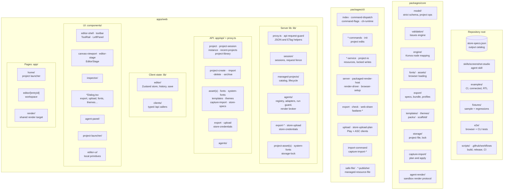

# Architecture Map

Where each part of Screenshot Studio lives and what it owns. This page is orientation only; the
contracts live in [`architecture.md`](architecture.md), which also has the flow diagrams (render
parity, persistence, trust boundaries). Nodes are folders or groups of files with one
responsibility, not individual files.

[`graph/index.html`](graph/index.html) shows the same areas as an interactive graph with the imports
and runtime links between them. Its areas are defined in `scripts/architecture-graph.mjs`, which must
assign every source file to exactly one area; `scripts/architecture-graph.test.ts` fails when a file
has no area or the committed `docs/graph/graph-data.js` misses an area or link. File counts on the
edges are not checked and refresh whenever the graph is regenerated. Run `pnpm graph:architecture`
after moving code between areas.

The map shows placement only. How the packages depend on each other is in
[System shape](architecture.md#1-system-shape): `apps/web` imports `cli` and `core`, `cli` imports
`core`, and at run time the CLI starts the web host and drives `/render`.

## Areas

### `packages/core`

| Area | Owns | Contract |
|---|---|---|
| `model/` | Strict Zod schema (`schema.ts`), Project ops, device frames, built-in font identities | [§2](architecture.md#2-project-model-and-ownership) |
| `validation/` | Issues engine shared by editor and `screenshots check` | [§3](architecture.md#3-rendering-and-export-parity) |
| `engine/` | `elementToNodeConfig`, `renderScreen`, text fit: the one Konva mapping | [§3](architecture.md#3-rendering-and-export-parity) |
| `fonts/`, `assets/` | Browser `FontFace` registration and image preloading before render | [§5](architecture.md#5-resources-and-trust-boundaries) |
| `export/` | Decoding `store-specs.json`, bundle entries, profiles, PNG flattening | [§3](architecture.md#3-rendering-and-export-parity) |
| `templates/`, `themes/`, `packs/`, `scaffold/` | Built-in starters, screen packs, Design packs, project packs, new-project scaffold | [§5](architecture.md#5-resources-and-trust-boundaries) |
| `storage/` | Project file read/write, mutation lock, no-follow open flags | [Locking](project-mutation-locking.md) |
| `capture-import/` | Capture discovery, plan, fingerprint, apply | [§5](architecture.md#5-resources-and-trust-boundaries) |
| `agent-render/` | File protocol for a sandboxed agent's render requests | [§6](architecture.md#6-interfaces-for-people-and-tools) |

### `packages/cli`

| Area | Files | Owns |
|---|---|---|
| Entry | `index.ts`, `command-dispatch.ts`, `command-flags.ts`, `cli-runtime.ts`, `update-check.ts` | Parsing and routing `screenshots` commands |
| Project commands | `init.ts`, `*-commands.ts`, `csv.ts`, `direction.ts` | Structural edits: layouts, screens, elements, locales, copy, assets, fonts, templates, themes, publishing ids |
| Resource services | `*-service.ts`, `project-io.ts`, `font-validation.ts`, `system-fonts.ts`, `managed-definition-store.ts` | Resource files and locked project writes |
| Render host | `server.ts`, `packaged-render-host.ts`, `render-driver.ts`, `render-host-readiness.ts`, `browser-setup.ts`, `render-through-editor.ts`, `launch-command.ts`, `dev-command.ts` | Starting the web host and driving `/render` with Playwright |
| Export | `export-command.ts`, `export.ts`, `check-command.ts`, `web-share.ts`, `fastlane-*.ts`, `store-ready-png.ts` | Bundles, profiles, `check --render` |
| Store upload | `upload-command.ts`, `app-store-upload-command.ts`, `store-upload-plan.ts`, `google-play-client.ts`, `app-store-connect-client.ts`, `store-credential-env.ts` | Human-only upload to Google Play and App Store Connect |
| Capture import | `import-command.ts`, `capture-import-transaction.ts`, `capture-import-recovery.ts` | Import transaction and crash recovery |
| File publication | `safe-file/`, `safe-file-publisher.ts`, `bundle-publisher.ts`, `managed-resource-file.ts`, `read-capped-body.ts` | [Safe file publication](safe-file-publication.md) |

### `apps/web`

| Area | Paths | Owns |
|---|---|---|
| Pages | `app/home/`, `app/editor/`, `app/render/` | Launcher, Workspace route, shared render target |
| UI | `components/` | Editor shell, canvas, inspector, dialogs, agent panel, project launcher, primitives ([editor.md](editor.md)) |
| Client state | `lib/editor/`, `lib/clients/` | Zustand store and history, typed API callers |
| API | `app/api/`, `proxy.ts` | Loopback-only routes for projects, resources, export, upload, agents |
| Request guard | `proxy.ts`, `lib/api-request-guard.server.ts`, `lib/api-error-response.server.ts`, `lib/json-*.ts`, `lib/http-etag.ts` | Loopback and same-origin guard, JSON and ETag helpers ([§4](architecture.md#4-project-sources-sessions-and-persistence)) |
| Sessions | `lib/session/` | Active session, request fence, Project Library, recents ([§4](architecture.md#4-project-sources-sessions-and-persistence)) |
| Managed projects | `lib/managed-projects/` | Managed catalog, lifecycle, archive, import |
| Server resources | `lib/project-asset*.server.ts`, `lib/system-fonts.server.ts`, `lib/storage-lock.server.ts`, `lib/private-json-document.server.ts` | Asset serving, system fonts, storage lock, private JSON documents |
| Agents | `lib/agents/`, `instrumentation.ts` | Agent registry, adapters, run guard, render broker ([§6](architecture.md#6-interfaces-for-people-and-tools)) |
| Output | `lib/export-*.ts`, `lib/store-upload*.ts`, `lib/store-credentials.server.ts`, `lib/store-key-folder.server.ts` | Export artifacts and progress, upload plan, key store |

### Repository root

| Area | Owns |
|---|---|
| `store-specs.json` | Output destinations, families, exact sizes |
| `skills/screenshot-studio/` | Optional agent skill that discovers or initializes a project |
| `fixtures/`, `examples/` | Sample and regression projects, usage examples |
| `e2e/` | Browser, parity, and packed-CLI tests ([testing.md](testing.md)) |
| `scripts/`, `.github/workflows/` | Build, package, release audit, CI ([releasing.md](releasing.md)) |
