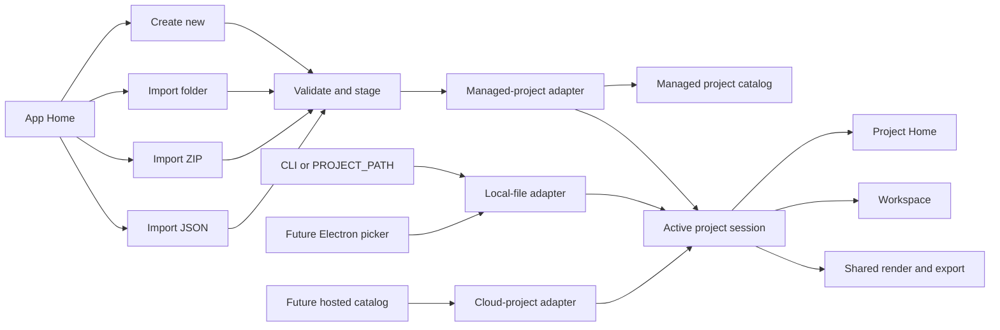
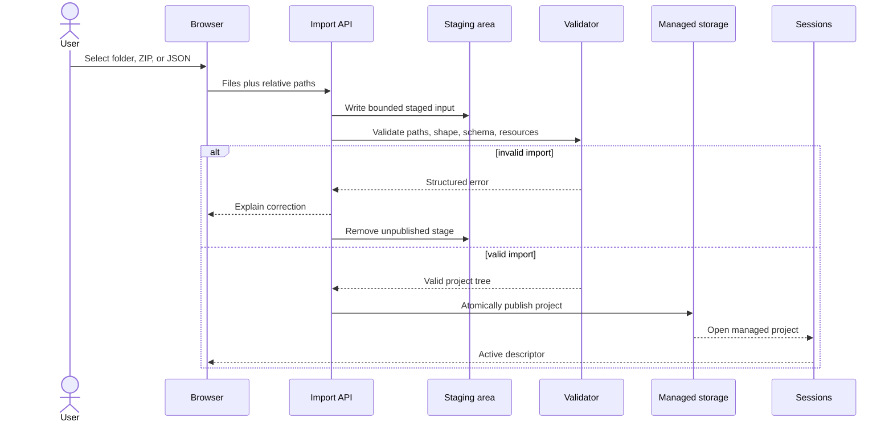

# Web project creation and import design

**Date:** 2026-07-18  
**Status:** Product direction approved; implementation plan pending  
**Scope:** App Home project creation/import, managed web projects, and portable project archives

## Summary

The web App Home must not ask a user to type an absolute filesystem path. That interaction exposes a
server implementation detail and does not match how a browser user normally creates or opens work.

The web launcher will instead offer:

1. **Create new project**.
2. **Import existing project** from a folder, a project archive, or a standalone JSON document.
3. **Recent projects** backed by the web application's managed project catalog.

The web application owns an imported copy. It does not claim to edit the selected source folder in
place. A future Electron shell can use the existing local-file source to open and save a folder in
place, while hosted deployments can replace managed local storage with an authorized cloud adapter.

The portable output action is named **Export project archive**. It produces a complete project ZIP,
not merely the rendered store images.

This design does not widen the strict Project schema and does not introduce a second render/export
path.

## Goals

- Replace the raw path field on web App Home with familiar create/import actions.
- Preserve the complete project directory tree, including project-relative resources.
- Give browser, local self-hosted, future Electron, and future hosted deployments an honest ownership
  model.
- Keep `app-store-screenshots.json` as the single persisted project document.
- Reuse active project sessions so Project Home, Workspace, APIs, renderer, and store-image export do
  not depend on the source picker.
- Let a user recover and transfer the complete managed project through **Export project archive**.
- Preserve `PROJECT_PATH` and `screenshots dev --project` for CLI automation and advanced local use.

## Non-goals

- Persisting browser file or directory handles.
- Editing the originally selected folder in place from the web application.
- Adding authentication, multi-user authorization, or a cloud database in this slice.
- Widening project fields to store source paths, catalog ids, import state, or credentials.
- Changing the existing rendered store-image export contract.
- Turning the CLI screenshot-capture `import` command into a project importer.

## User experience

### App Home

App Home presents two primary actions:

- **Create new project**
- **Import existing project**

Import expands or opens a focused choice surface with:

- **Project folder** — the recommended web option.
- **Project archive (.zip)** — the portable one-file option.
- **Project JSON** — a limited option for self-contained documents.

Below the primary actions, App Home lists recent managed projects when any exist. A first-time user
does not see an empty recent-project section.

No normal web surface exposes an absolute server path. `PROJECT_PATH` remains an advanced startup
input and is not rendered as a form field.

### Create new project

The create flow asks for the project name and creates the smallest valid starter project. The starter
factory and scaffold rules must be shared with, or deliberately aligned to, `screenshots init`; web
and CLI must not drift into different default Project documents.

After durable creation and strict validation, the application creates an active session and routes to
Project Home.

### Import a project folder

The user chooses the directory that contains `app-store-screenshots.json`. The browser supplies its
files and relative paths; the web application imports the directory tree into a managed project.

The source directory is read as import input only. Subsequent saves update the managed copy. The UI
must state this before confirmation so "import" is not mistaken for in-place editing.

### Import a project archive

The user selects a ZIP created by **Export project archive** or another ZIP matching the same project
directory contract. Folder and ZIP inputs converge on the same validation and publication pipeline.

### Import a standalone JSON document

The application first parses the strict Project document and enumerates project-relative resource
references. If no local resources are required, it creates a managed project containing the JSON.

If local assets or fonts are referenced, the application does not activate a knowingly incomplete
project. It explains which resources are absent and asks the user to select the project folder or a
project archive instead. This is a validation result, not a schema error.

### Project Home

Project Home identifies the managed project without displaying a raw server path. It exposes:

- entry to the Workspace;
- project identity and managed-source label;
- **Export project archive** for complete project portability.

The existing rendered-image export remains a separate Workspace/project operation with its existing
meaning.

## Architecture



The active-session descriptor remains source-neutral. Consumers resolve a session and its
capabilities; they do not branch on an environment variable or assume that all projects have a local
path.

### Source kinds

| Source | Selection | Persistence | Visible location | Write behavior |
|---|---|---|---|---|
| Managed web project | Create, folder import, ZIP import, or JSON import | Application-managed project directory | Project name / managed label | Saves managed copy |
| Local file | CLI path or future Electron native picker | User-selected directory | Safe local path when the shell may expose it | Saves in place |
| Future cloud project | Authenticated catalog | Provider storage | Workspace/project label | Provider-defined |

The web import pipeline adds a `managed-project` source rather than weakening `local-file`. The
existing local-file adapter remains the correct behavior for CLI and future desktop shells.

### Managed storage

The server owns a configurable managed-storage root. Each project has an opaque generated id and its
own directory:

```text
<managed-root>/
  projects/
    <project-id>/
      app-store-screenshots.json
      assets/
      templates/
      themes/
      ...
```

The catalog stores shell/application metadata such as project id, display name, creation/update time,
and source label outside `app-store-screenshots.json`. It never stores this state in the Project
schema.

The storage root is deployment configuration. Business logic depends on a managed-project repository
boundary rather than a hard-coded home directory, making an OS app-data location, a container volume,
or a future cloud implementation interchangeable.

## Import and publication pipeline

Folder, ZIP, and JSON inputs normalize to a staged set of relative files:



Validation and publication rules:

1. Apply configurable total-size, file-count, and per-file limits before durable publication.
2. Reject absolute paths, traversal segments, duplicate normalized paths, and entries outside the
   selected project root.
3. ZIP extraction rejects symlinks and other unsupported entry kinds and is protected against
   decompression bombs by the same limits.
4. Require exactly one root `app-store-screenshots.json`.
5. Parse the document with the strict core schema.
6. Validate project-relative resources that are required for an immediately usable project.
7. Publish from staging atomically so a failed import never appears in recents.
8. Create the active session only after publication succeeds.
9. Preserve the previously active session if any step fails.

Existing safe-file-publication and mutation-locking contracts remain authoritative for writes inside
a published local managed project. Import staging adds a separate untrusted-input boundary before
those normal project services are reachable.

## Project archive contract

**Export project archive** creates a ZIP whose root contains `app-store-screenshots.json` and the
project-relative files required to reopen the project. It preserves relative paths and excludes:

- managed catalog metadata;
- session ids and recent-project state;
- lock, staging, temporary, and backup files;
- credentials and deployment configuration;
- rendered export output unless the archive contract explicitly adds it in a future version.

The archive must be importable by the same application version that created it. Archive creation
reads one coherent project snapshot under the appropriate project read/mutation coordination so the
JSON and resources do not represent different saves.

The project archive is distinct from the store-image export bundle. UI labels, endpoints, and tests
must keep those two artifacts unambiguous.

## Error behavior

| Failure | User-visible behavior | Durable result |
|---|---|---|
| User cancels picker | Return to App Home without an alert | No project or stage |
| Invalid Project JSON | Show strict validation summary | No catalog entry |
| JSON references local resources | List missing resources; offer folder/archive import | No catalog entry |
| Folder has no root project JSON | Explain expected root file | No catalog entry |
| Folder has multiple candidate roots | Ask for the actual project root | No catalog entry |
| Unsafe ZIP/path entry | Reject archive with a safe generic explanation | No catalog entry |
| Limit exceeded | Name the applicable upload limit | No catalog entry |
| Publication fails | Show retryable storage failure | No partial catalog entry |
| Session activation fails after publication | Keep prior session; allow reopening the published project | Valid catalog project remains |
| Archive export fails | Keep project active and report export failure | Project remains unchanged |

Errors must not print unsafe server paths in hosted/browser UI. Server logs may retain appropriately
scoped diagnostic context under the repository's existing logging policy.

## API and component boundaries

The implementation plan should preserve these logical responsibilities even if exact names change:

- `ProjectLauncher` renders create/import/recents and owns picker interaction only.
- A create/import client translates browser files into transport requests and progress state.
- A managed-project service owns ids, catalog metadata, staging, validation, publication, and archive
  assembly.
- A `managed-project` source adapter opens published projects as active sessions.
- Project-bound APIs continue resolving the active session rather than accepting arbitrary paths.
- A project-archive endpoint streams the portable archive without changing store-image export APIs.

The import transport may begin as multipart form data for the local self-hosted slice. Limits,
streaming behavior, and cleanup must be explicit in the implementation plan; the architecture must
not require buffering an unbounded folder or ZIP in memory.

## Compatibility and migration

- `PROJECT_PATH=... pnpm dev` continues to seed a local-file session.
- `screenshots dev --project ...` continues to open the same local-file source.
- Removing the raw path field does not remove the local-file adapter or its tested security contract.
- A seeded local project may appear directly on Project Home, but it is not silently copied into
  managed storage.
- Existing managed storage must tolerate server restarts; active in-memory sessions may be restored
  by reopening their catalog entry.
- The bundled sample remains opt-in and is never silently selected or overwritten.

## Documentation changes

Implementation must update these sources of truth:

- `README.md`: Quick Start, web create/import workflow, managed-copy explanation, CLI path flow, and
  **Export project archive**.
- `docs/editor.md`: App Home states, import variants, validation/error states, Project Home actions,
  and terminology.
- `docs/architecture.md`: managed-project adapter, deployment mapping, import pipeline, storage
  ownership, archive contract, and updated diagrams/examples.
- `docs/testing.md`: exact ownership and cost boundaries for importer, archive, API integration, and
  point-targeted launcher E2E coverage.

The previous local self-hosted example that asks a web user to type an absolute path must be replaced
with an import example. The absolute-path example remains appropriate only for CLI/advanced startup
documentation.

## Verification strategy

### Core/service tests

- Starter project validity and CLI/web default parity.
- Folder tree normalization and resource-reference discovery.
- Safe path handling, duplicate normalization, limits, and cleanup.
- ZIP extraction and archive round-trip.
- Atomic publication and catalog consistency under injected failures.
- Coherent archive assembly and exclusion rules.

### Web/API tests

- Create, folder import, ZIP import, and standalone JSON import.
- Structured failures do not replace the previous active session.
- Project-bound routes resolve managed and local sessions identically.
- Recents include only published managed projects.
- Archive endpoint is distinct from rendered-image export.

### Point-targeted E2E

- First launch shows Create and Import with no path field.
- Create reaches Project Home and Workspace.
- Folder import preserves an asset used on canvas.
- JSON with missing resources directs the user to folder/archive import.
- Exported archive imports as an equivalent project.
- A CLI-seeded local session still reaches the same Project Home.

Full browser suites remain governed by `docs/testing.md`; the local implementation loop should use
the smallest exact launcher/import groups.

## Acceptance criteria

- A normal web user never types an absolute project path.
- A new project can be created and reopened from recents after a server restart.
- A complete folder or project archive imports without losing relative resources.
- Standalone JSON never silently creates a broken resource-dependent project.
- Failed imports leave no visible partial project and do not replace the active session.
- Managed projects and CLI/Electron-style local projects use the same Project schema, sessions,
  renderer, and store-image export path.
- **Export project archive** produces a portable artifact that round-trips through archive import.
- README, editor, architecture, and testing documentation match the implemented behavior.

